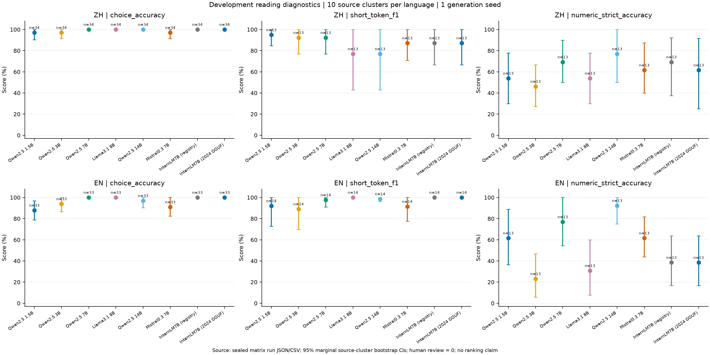
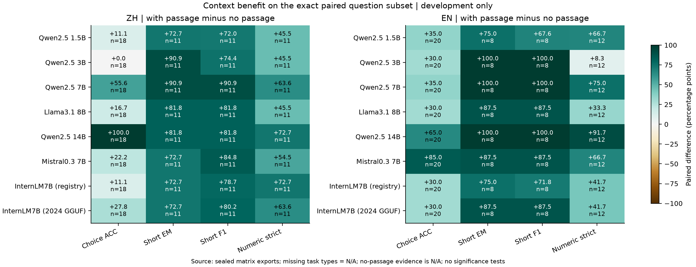

# Reading Ability / Round 1 / Development Comparison / 2026-10-20

## 1. 执行结论

服务器GPU推理和平台已可实际使用。完成7款基础模型、8个配置的28个run，共2,064条真实模型调用及响应记录，全部run完成；270条响应被严格输出/评分契约判为错误，保留原文、计零、不重试删除。调用完成不代表答案正确。本次为首次完整20篇开发题稿矩阵，记为本实验线r01；不代表正式测试轮次。

完成量：8×160=1,280条有原文；8×80=640条同题无原文；8×10=80条合成数字改文；另有64条16题pilot工程回归。主分析仅含前两组1,920条（其中257条契约错误），改文和pilot单列。20篇真实来源文章中英文各10篇80题，共160题；10个合成案例不新增真实文章。

当前决策：平台可现场演示，可继续开发测评；不发布正式能力榜单。优先改进干扰项、证据输出契约和人工审题，再冻结100篇隐藏集。候选正文402篇与可执行开发题库20篇是不同状态。

## 2. 实验身份与决策问题

同系列比较Qwen2.5 1.5B/3B/7B/14B；近似规模跨机构比较Qwen7B、Mistral7B v0.3、InternLM2.5-7B，Llama3.1-8B为邻近规模补充。两种InternLM分发计为两个配置、同一基础模型；不算两家公司。规模/公司变化同时改变训练数据、架构、分词器等，只作观察比较。

原五个模型对比保留。独立来源核验后、查看InternLM得分前，追加官方2024 GGUF配置和一个配对。registry GGUF的226个量化tensor与三项tokenizer元数据不同于官方文件；差异不能证明重新训练或污染，但不能认证为同一历史转换。官方新配置完整SHA已匹配2024固定revision，原配置归为分发待核探索参照。见[逐tensor核验](../output/internlm-gguf-provenance-20261020.md)。

## 3. 设置与指标

GPU0为RTX3090 24GiB；自有Ollama 0.13.5、单模型驻留/单请求并发。统一Q4_K_M、temperature=0、seed=42、上下文8192、输出上限512。8个配置的主/无文/改文run均采样观察到完整GPU驻留；这不是每一时刻的设备追踪证明。权重在服务器`/home/jmy/reading-bench/runtime/models`（当前约34G，含保留的下载缓存），本机只接收小tokenizer和结果。

Qwen四个规模使用冻结官方tokenizer/原生raw模板，记录实际token一致性。其余四个配置采用保守预算和实际计数，未严格认证tokenizer等价。所有配置均为`allow_draft=true, strict_time=true, strict_budget=false`，不冒充正式严格预算实验。

选择题用ACC，短答用规范化EM及项目字符/词重叠F1，数值题同时要求数值和单位正确；证据按一套完整支持链给集合EM及P/R/F1。正确拒答、无答案实质作答、可答题误拒和契约错误分开看。F1不是官方SQuAD/LongBench分数。所有失败留在计划分母，valid-output子集仅辅助；无文条件证据指标不适用。实质作答率/误拒答率在错误响应上也记0，低值不能独立解释为少幻觉。

## 4. 主要观察

以下为有原文点估计，单位%。中文每模型：选择34、短答13、数值13、可答证据60、无答案20；英文分别33、14、13、60、20。顺序不按得分排序。全部区间和任务分解见[numeric-table.csv](../output/analysis-20261020/numeric-table.csv)。

| 配置 | 语言 | 选择 ACC | 短答 F1 | 数值严格 ACC | 证据 EM | 正确拒答 |
|---|---|---:|---:|---:|---:|---:|
| Qwen2.5 1.5B | zh | 97.1 | 94.9 | 53.8 | 18.3 | 0.0 |
| Qwen2.5 1.5B | en | 87.9 | 92.1 | 61.5 | 16.7 | 0.0 |
| Qwen2.5 3B | zh | 97.1 | 92.3 | 46.2 | 66.7 | 20.0 |
| Qwen2.5 3B | en | 93.9 | 89.0 | 23.1 | 56.7 | 5.0 |
| Qwen2.5 7B | zh | 100.0 | 92.3 | 69.2 | 20.0 | 80.0 |
| Qwen2.5 7B | en | 100.0 | 97.6 | 76.9 | 50.0 | 15.0 |
| Llama3.1 8B | zh | 100.0 | 76.9 | 53.8 | 51.7 | 30.0 |
| Llama3.1 8B | en | 100.0 | 100.0 | 30.8 | 80.0 | 50.0 |
| Qwen2.5 14B | zh | 100.0 | 76.9 | 76.9 | 71.7 | 15.0 |
| Qwen2.5 14B | en | 97.0 | 98.6 | 92.3 | 80.0 | 65.0 |
| Mistral0.3 7B | zh | 97.1 | 87.2 | 61.5 | 70.0 | 20.0 |
| Mistral0.3 7B | en | 90.9 | 91.4 | 61.5 | 68.3 | 30.0 |
| InternLM7B (registry) | zh | 100.0 | 87.2 | 69.2 | 18.3 | 0.0 |
| InternLM7B (registry) | en | 100.0 | 100.0 | 38.5 | 55.0 | 0.0 |
| InternLM7B (2024 GGUF) | zh | 100.0 | 87.2 | 61.5 | 23.3 | 0.0 |
| InternLM7B (2024 GGUF) | en | 100.0 | 100.0 | 38.5 | 65.0 | 15.0 |

选择题多处达到100%，说明现有干扰项区分度有限；参数更多也没有在所有任务单调提高。比如Qwen14B中文短答F1为76.9%，Qwen7B为92.3%，样本各13题，不能据此断言小模型总体更强。应先检查任务覆盖与题目质量。

证据格式有实质影响：Qwen7B中文严格证据EM为12/60，仅做方括号/唯一短ID格式归一化的事后辅助值为44/60。该差额支持改进引用契约；语义证据错误仍存在，主成绩不回改。详见[格式敏感性诊断](../output/analysis-20261020/evidence-id-diagnostic.md)。

合成改文中Qwen7B严格跟随新值10/10；其他配置有不同程度失败。80个改文响应里合法解析的数值没有匹配旧值，但部分回答无效/错误，不能写成80/80正确，也不能据此证明无训练污染。仅5题/语言，保持描述性。见[改文结果](../output/analysis-20261020/counterfactual-report.md)。

## 5. 统计验证

以每语言10个暂定来源文章簇配对bootstrap 2,000次，生成边际95%区间；模型及有/无文使用相同簇重采样索引。无文只取每篇预先固定q01—q04，共80题，与有文完全相同题匹配，不能用160题总均值直接相减。

只有一次生成seed，没有跨seed方差。簇谱系未完成人工复核，政府/机构来源偏多；小簇区间是探索性结果。全对的有限样本可能给出[100,100] bootstrap区间，不代表总体无不确定性。不做显著性检验、p值排序或胜者声明。预定比较均已覆盖，详细效应量与CI见[统计附录](../output/analysis-20261020/stats-appendix.md)和[配对差值](../output/analysis-20261020/paired-differences.json)。

## 6. 图解与决策

图1比较各任务点估计、适用题数与簇区间。选择题集中高分，数值任务分散、区间较宽；短答高分与数值/证据较差可同时发生。应补充困难干扰项、数值运算和整合证据题，而不是只增加相同简单选择题。

图2只比较匹配题目。Qwen7B选择题原文收益：中文+55.6个百分点（18题）、英文+35.0个百分点（20题）。这支持这些题目中使用原文有帮助；收益包含契约遵循变化、先验知识和题型难度，不能当作纯理解增益或污染率。详细CI另列，不以格子颜色判断显著性。

## 7. 失败、负结果与边界

真实错例包括Qwen7B零售差额答-3142而金标3279、早稻差额答75.1而金标51.8；有引用正确但计算错误，也有答案正确而引用错误。拒答时在answer写解释会触发`refusal_contains_answer_or_evidence`，这不能全部归为幻觉。原始输出、错误类型和效率见[wrong-cases.json](../output/analysis-20261020/wrong-cases.json)、[error-types.json](../output/analysis-20261020/error-types.json)、[efficiency.json](../output/analysis-20261020/efficiency.json)。

题目均为AI草稿，人审0。中英文不是等难翻译题，Llama3.1官方支持语言不含中文，Mistral中文能力覆盖未独立核实。当前材料以新闻/机构文本为主，长度不是最大长上下文压力测试。执行时间含加载/调度/序列化，warm_proxy只去整个run第一条，不能当纯解码延迟。

资料发布日期晚于所登记历史模型版本，只能降低可观察风险；转引早稿、预印本、已知事实仍可能被模型训练见过。无文答对可能来自常识或猜测，不是污染定论；近期文章、固定digest和改文测试也不构成绝对无污染证明。

## 8. 本轮改变的判断

工程上已从早期CPU超时状态进入可重复GPU批量评测。方法上应把“答案”“证据”“输出契约”同时记录并分开解释；仅以选择题ACC评价阅读会丢失关键差异。权重分发名称也不足以确认历史身份，InternLM对照说明文件谱系审计需前置。

## 9. 后续调整

1. 先由两名独立审题者复核20篇开发题，仲裁答案、单位、支持链和无答案判定；保留当前版本快照，不追着模型输出修改旧金标。
2. 预先定义新版本的简单证据ID与拒答契约，统一应用全部模型，冻结提示/评分版本后重新验证；格式辅助诊断不能替代重测。
3. 从402篇候选中完成100篇隐藏集（50中、50英）的源文时间/早期版本审查及8题/篇标注；人审和冻结前不进入正式榜单。降低来源集中度、提高选择题干扰项难度。
4. 完成非Qwen分词/模板认证，正式比较优先采用可核验历史权重；保留Qwen四规模、近7B跨机构和Llama8B邻近规模矩阵。隐藏集禁止调参，扩展多seed及预定主比较/多重检验方案。

## 10. 复现与交付索引

- [运行和恢复说明](model-matrix-usage.md)、[开发题内容审查](dev-expanded-content-audit-20261020.md)、[完整分析](../output/analysis-20261020/analysis-report.md)、[图目录](../output/analysis-20261020/figure-catalog.md)。
- [交付核验清单](../output/delivery-20261020.json)列28个run、原始导出hash、实际attempt数及GPU观察；各matrix目录保留JSON/CSV/manifest/设备观察。模型完整digest见分析的model_snapshots。
- 主题库canonical SHA256：`8d37696d74067a2095f800192e8398b85f72d1ef09ca254f0da3f0ffb2c99a3f`；16题pilot和合成题库单独封存。
- 平台和模型服务位于项目独立tmux会话；一致性SQLite备份在服务器`runtime/deployments/20261020/bench-final.sqlite3`。本机用`./connect-server.ps1`后访问<http://127.0.0.1:8877/#v2experiment>，保持隧道终端。
- 53项Python单元测试及前端JS语法检查已通过；本报告交付脚本再次核对28个run的身份、hash、CSV/JSON、逐题评分、2064个唯一attempt与非空原始响应。浏览器已验证真实完成页面及多组证据链展示。
- 当前项目未绑定Obsidian知识库，报告保存为本地Markdown，未尝试Obsidian写回。

操作决定：保留本轮开发诊断和全部失败记录；下一阶段先完成审题及新协议冻结，再启动正式隐藏测试。
