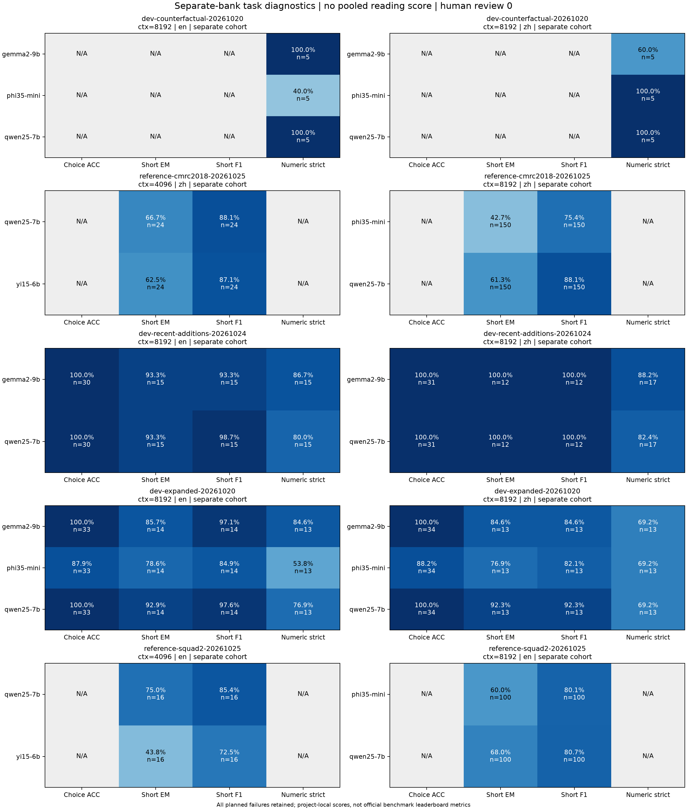
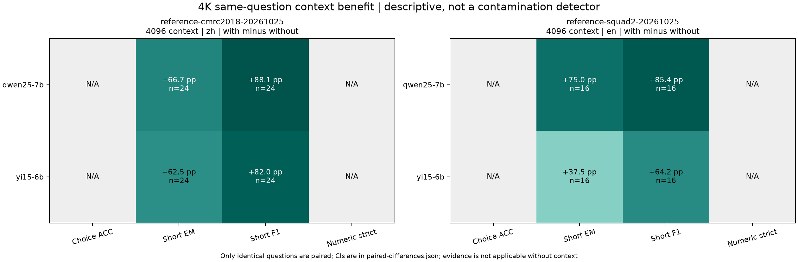

# Reading Ability / Round 2 / Model and Data Expansion / 2026-10-25

## 1. 执行结论

已完成本轮模型及数据扩展：新增Gemma2 9B、Phi3.5 mini（3.8B）、Yi1.5 6B，当前共10款基础模型、11配置（两种InternLM分发仍单列）。近期开发题由20篇160题增至40篇320题，中英各20篇160题；另外接入SQuAD2、CMRC2018各50个完整参考篇章、150题。共620道题（按文章及题目ID去重）；汇总视图、4K子集与10例合成诊断均不重复计入这个数。参考篇章共享35/50个原始标题簇，不能称100篇独立近期文章。

完成13份矩阵、23个run、1862次真实调用，218条响应错误保留计零。与10月20日已封存2064次相加为3926条两轮调用记录；它们不是3926道独立题，也不自动构成统一排名。全部新模型/题库已接入平台，支持真实运行、原始响应回查与导出。

## 2. 本轮身份与比较问题

本实验线r02接续10月20日r01开发诊断。本轮回答：新增不同机构历史固定模型是否能在相同材料上执行；新近不同领域材料与公开阅读参考是否能补充任务覆盖；Yi原生4K下的完整篇章子集如何表现。不是全部11配置×620题的完整交叉矩阵。

跨机构也同时改变参数量、训练数据、架构、分词器与模板；这些观察比较不能归因于“公司”这一单因素。不同参数规模的原Qwen四模型结果仍保留在r01，本轮主要增加机构与数据覆盖。

| 阶段 | 模型与条件 | 调用 |
|---|---|---:|
| 旧开发集同批桥接 | Gemma2、Phi3.5、Qwen7B各160有文+80无文 | 720 |
| 合成改文 | 上述三模型各10例 | 30 |
| 公开参考全子集 | Qwen7B、Phi3.5各150 SQuAD+150 CMRC，8K有文 | 600 |
| 原生4K配对子集 | 每集8个不同标题簇24题，Qwen7B/Yi各有文及无文 | 192 |
| 新增近期材料 | Qwen7B、Gemma2各160有文 | 320 |
| 合计 | 23个run，13个matrix | 1862 |

每模型记录数：gemma2-9b: 410, phi35-mini: 550, qwen25-7b: 806, yi15-6b: 96。Qwen7B本轮锚点在新模型测试已开始后、尚未检查答案和证据成绩时追加（已能看到运行状态及错误计数），以保持相同runner/GPU的参考；不冒充原始预注册。所有自动枚举模型差值均为探索分析。

## 3. 设置、材料与评价协议

模型权重仅下载到服务器`/home/jmy/reading-bench/runtime/models`。三款新增配置固定Q4_K_M、完整manifest和全部本地blob SHA；原模型发行证据在2024年，但registry转换链未独立复现，不宣称历史字节完全等于作者原始权重。Gemma以英语为主，其中文观察属探索；Phi/Yi语言覆盖与许可详见[来源记录](model-expansion-sources-20261024.md)。Gemma为自定义条款、Phi MIT、Yi Apache2.0；未代用户进行gated登录或点击接受新协议。

GPU0由其他项目使用，本项目自有Ollama迁GPU1（RTX3090 24GiB），只改项目进程、不终止其他任务。单模型/单请求并发，temperature0、seed42、输出512；Gemma/Phi/Qwen常规8192，Yi及配对基线4096。Yi原生只有4096，保留registry ChatML模板；作者HF模板含字面反斜杠换行差异，因此冻结小tokenizer仅作审计，没有冒称运行模板等价认证。4K仅选完整篇章预算适用子集，不截断正文。

近期新20篇与旧20篇源ID及正文SHA无重叠。192个原段逐字对齐，中文和英文各由独立AI代理完整审读；首次推理前修正8处实质问题及名称别名/支持链。人审仍0，formal=false。新增题目覆盖地学、能源、材料、公共文化、居民收支、学生资助、旱情、金融服务、航天与地质资源；61选择、27短答、32数值、40无答案。选择项按固定seed平衡，未按模型输出改金标。

公开集保留官方原文、问题、答案和offset。CMRC原始转换中存在176条至少一个偏移不匹配的题，按事先检查排除，没有修正后当原始金标。SQuAD同标题篇章跨长度层曾在首次创建时HTTP400拒绝、尚无run/推理；原导入版封存，20261025执行版只统一标题簇分层并保留原长度。公开参考关闭时间隔离，可能已训练见过；span机械映射证据仅作辅助，项目评分不是官方榜单成绩。

## 4. 分题库结果

以下只报告有文条件，并分别保留窗口/模型/语言。短答EM/F1、选择ACC、数值及单位严格ACC、正确拒答与错误率分开解释，不合成一个阅读总分。所有错误保留在适用计划分母；证据proxy与真实支持链开发诊断另列在完整数值表。无适用题型为N/A。

### dev-counterfactual-20261020

| 窗口 | 模型 | 语言 | 指标 | 点估计% | 题数 | 95%探索区间% |
|---:|---|---|---|---:|---:|---|
| 8192 | gemma2-9b | en | numeric_strict_accuracy | 100.0 | 5 | [100.0, 100.0] |
| 8192 | gemma2-9b | en | format_error_rate | 0.0 | 5 | [0.0, 0.0] |
| 8192 | gemma2-9b | zh | numeric_strict_accuracy | 60.0 | 5 | [20.0, 100.0] |
| 8192 | gemma2-9b | zh | format_error_rate | 20.0 | 5 | [0.0, 60.0] |
| 8192 | phi35-mini | en | numeric_strict_accuracy | 40.0 | 5 | [0.0, 80.0] |
| 8192 | phi35-mini | en | format_error_rate | 0.0 | 5 | [0.0, 0.0] |
| 8192 | phi35-mini | zh | numeric_strict_accuracy | 100.0 | 5 | [100.0, 100.0] |
| 8192 | phi35-mini | zh | format_error_rate | 0.0 | 5 | [0.0, 0.0] |
| 8192 | qwen25-7b | en | numeric_strict_accuracy | 100.0 | 5 | [100.0, 100.0] |
| 8192 | qwen25-7b | en | format_error_rate | 0.0 | 5 | [0.0, 0.0] |
| 8192 | qwen25-7b | zh | numeric_strict_accuracy | 100.0 | 5 | [100.0, 100.0] |
| 8192 | qwen25-7b | zh | format_error_rate | 0.0 | 5 | [0.0, 0.0] |

### dev-expanded-20261020

| 窗口 | 模型 | 语言 | 指标 | 点估计% | 题数 | 95%探索区间% |
|---:|---|---|---|---:|---:|---|
| 8192 | gemma2-9b | en | choice_accuracy | 100.0 | 33 | [100.0, 100.0] |
| 8192 | gemma2-9b | en | short_em | 85.7 | 14 | [66.7, 100.0] |
| 8192 | gemma2-9b | en | short_token_f1 | 97.1 | 14 | [93.3, 100.0] |
| 8192 | gemma2-9b | en | numeric_strict_accuracy | 84.6 | 13 | [62.5, 100.0] |
| 8192 | gemma2-9b | en | correct_refusal_rate | 95.0 | 20 | [85.0, 100.0] |
| 8192 | gemma2-9b | en | format_error_rate | 1.2 | 80 | [0.0, 3.8] |
| 8192 | gemma2-9b | zh | choice_accuracy | 100.0 | 34 | [100.0, 100.0] |
| 8192 | gemma2-9b | zh | short_em | 84.6 | 13 | [53.8, 100.0] |
| 8192 | gemma2-9b | zh | short_token_f1 | 84.6 | 13 | [53.8, 100.0] |
| 8192 | gemma2-9b | zh | numeric_strict_accuracy | 69.2 | 13 | [50.0, 88.9] |
| 8192 | gemma2-9b | zh | correct_refusal_rate | 45.0 | 20 | [20.0, 70.0] |
| 8192 | gemma2-9b | zh | format_error_rate | 13.8 | 80 | [7.5, 20.0] |
| 8192 | phi35-mini | en | choice_accuracy | 87.9 | 33 | [73.5, 100.0] |
| 8192 | phi35-mini | en | short_em | 78.6 | 14 | [57.1, 100.0] |
| 8192 | phi35-mini | en | short_token_f1 | 84.9 | 14 | [63.5, 100.0] |
| 8192 | phi35-mini | en | numeric_strict_accuracy | 53.8 | 13 | [28.6, 78.6] |
| 8192 | phi35-mini | en | correct_refusal_rate | 0.0 | 20 | [0.0, 0.0] |
| 8192 | phi35-mini | en | format_error_rate | 27.5 | 80 | [25.0, 31.2] |
| 8192 | phi35-mini | zh | choice_accuracy | 88.2 | 34 | [73.5, 100.0] |
| 8192 | phi35-mini | zh | short_em | 76.9 | 13 | [41.7, 100.0] |
| 8192 | phi35-mini | zh | short_token_f1 | 82.1 | 13 | [55.5, 100.0] |
| 8192 | phi35-mini | zh | numeric_strict_accuracy | 69.2 | 13 | [57.9, 87.5] |
| 8192 | phi35-mini | zh | correct_refusal_rate | 0.0 | 20 | [0.0, 0.0] |
| 8192 | phi35-mini | zh | format_error_rate | 18.8 | 80 | [13.8, 23.8] |
| 8192 | qwen25-7b | en | choice_accuracy | 100.0 | 33 | [100.0, 100.0] |
| 8192 | qwen25-7b | en | short_em | 92.9 | 14 | [72.7, 100.0] |
| 8192 | qwen25-7b | en | short_token_f1 | 97.6 | 14 | [90.9, 100.0] |
| 8192 | qwen25-7b | en | numeric_strict_accuracy | 76.9 | 13 | [53.8, 100.0] |
| 8192 | qwen25-7b | en | correct_refusal_rate | 15.0 | 20 | [0.0, 30.0] |
| 8192 | qwen25-7b | en | format_error_rate | 20.0 | 80 | [16.2, 23.8] |
| 8192 | qwen25-7b | zh | choice_accuracy | 100.0 | 34 | [100.0, 100.0] |
| 8192 | qwen25-7b | zh | short_em | 92.3 | 13 | [76.9, 100.0] |
| 8192 | qwen25-7b | zh | short_token_f1 | 92.3 | 13 | [76.9, 100.0] |
| 8192 | qwen25-7b | zh | numeric_strict_accuracy | 69.2 | 13 | [50.0, 88.9] |
| 8192 | qwen25-7b | zh | correct_refusal_rate | 80.0 | 20 | [59.9, 100.0] |
| 8192 | qwen25-7b | zh | format_error_rate | 3.8 | 80 | [0.0, 7.5] |

### dev-recent-additions-20261024

| 窗口 | 模型 | 语言 | 指标 | 点估计% | 题数 | 95%探索区间% |
|---:|---|---|---|---:|---:|---|
| 8192 | gemma2-9b | en | choice_accuracy | 100.0 | 30 | [100.0, 100.0] |
| 8192 | gemma2-9b | en | short_em | 93.3 | 15 | [76.9, 100.0] |
| 8192 | gemma2-9b | en | short_token_f1 | 93.3 | 15 | [76.9, 100.0] |
| 8192 | gemma2-9b | en | numeric_strict_accuracy | 86.7 | 15 | [72.2, 100.0] |
| 8192 | gemma2-9b | en | correct_refusal_rate | 95.0 | 20 | [85.0, 100.0] |
| 8192 | gemma2-9b | en | format_error_rate | 1.2 | 80 | [0.0, 3.8] |
| 8192 | gemma2-9b | zh | choice_accuracy | 100.0 | 31 | [100.0, 100.0] |
| 8192 | gemma2-9b | zh | short_em | 100.0 | 12 | [100.0, 100.0] |
| 8192 | gemma2-9b | zh | short_token_f1 | 100.0 | 12 | [100.0, 100.0] |
| 8192 | gemma2-9b | zh | numeric_strict_accuracy | 88.2 | 17 | [72.2, 100.0] |
| 8192 | gemma2-9b | zh | correct_refusal_rate | 55.0 | 20 | [30.0, 80.0] |
| 8192 | gemma2-9b | zh | format_error_rate | 11.2 | 80 | [5.0, 17.5] |
| 8192 | qwen25-7b | en | choice_accuracy | 100.0 | 30 | [100.0, 100.0] |
| 8192 | qwen25-7b | en | short_em | 93.3 | 15 | [80.0, 100.0] |
| 8192 | qwen25-7b | en | short_token_f1 | 98.7 | 15 | [96.0, 100.0] |
| 8192 | qwen25-7b | en | numeric_strict_accuracy | 80.0 | 15 | [64.7, 100.0] |
| 8192 | qwen25-7b | en | correct_refusal_rate | 0.0 | 20 | [0.0, 0.0] |
| 8192 | qwen25-7b | en | format_error_rate | 23.8 | 80 | [21.2, 25.0] |
| 8192 | qwen25-7b | zh | choice_accuracy | 100.0 | 31 | [100.0, 100.0] |
| 8192 | qwen25-7b | zh | short_em | 100.0 | 12 | [100.0, 100.0] |
| 8192 | qwen25-7b | zh | short_token_f1 | 100.0 | 12 | [100.0, 100.0] |
| 8192 | qwen25-7b | zh | numeric_strict_accuracy | 82.4 | 17 | [65.0, 100.0] |
| 8192 | qwen25-7b | zh | correct_refusal_rate | 85.0 | 20 | [65.0, 100.0] |
| 8192 | qwen25-7b | zh | format_error_rate | 1.2 | 80 | [0.0, 3.8] |

### reference-cmrc2018-20261025

| 窗口 | 模型 | 语言 | 指标 | 点估计% | 题数 | 95%探索区间% |
|---:|---|---|---|---:|---:|---|
| 8192 | phi35-mini | zh | short_em | 42.7 | 150 | [34.0, 51.3] |
| 8192 | phi35-mini | zh | short_token_f1 | 75.4 | 150 | [70.4, 80.1] |
| 8192 | phi35-mini | zh | format_error_rate | 0.0 | 150 | [0.0, 0.0] |
| 4096 | qwen25-7b | zh | short_em | 66.7 | 24 | [45.8, 87.5] |
| 4096 | qwen25-7b | zh | short_token_f1 | 88.1 | 24 | [79.4, 97.2] |
| 4096 | qwen25-7b | zh | format_error_rate | 0.0 | 24 | [0.0, 0.0] |
| 8192 | qwen25-7b | zh | short_em | 61.3 | 150 | [53.3, 69.3] |
| 8192 | qwen25-7b | zh | short_token_f1 | 88.1 | 150 | [84.6, 91.5] |
| 8192 | qwen25-7b | zh | format_error_rate | 0.0 | 150 | [0.0, 0.0] |
| 4096 | yi15-6b | zh | short_em | 62.5 | 24 | [37.5, 83.3] |
| 4096 | yi15-6b | zh | short_token_f1 | 87.1 | 24 | [77.5, 95.4] |
| 4096 | yi15-6b | zh | format_error_rate | 0.0 | 24 | [0.0, 0.0] |

### reference-squad2-20261025

| 窗口 | 模型 | 语言 | 指标 | 点估计% | 题数 | 95%探索区间% |
|---:|---|---|---|---:|---:|---|
| 8192 | phi35-mini | en | short_em | 60.0 | 100 | [50.0, 69.4] |
| 8192 | phi35-mini | en | short_token_f1 | 80.1 | 100 | [73.1, 86.4] |
| 8192 | phi35-mini | en | correct_refusal_rate | 0.0 | 50 | [0.0, 0.0] |
| 8192 | phi35-mini | en | format_error_rate | 10.7 | 150 | [6.5, 14.9] |
| 4096 | qwen25-7b | en | short_em | 75.0 | 16 | [56.2, 93.8] |
| 4096 | qwen25-7b | en | short_token_f1 | 85.4 | 16 | [68.8, 97.9] |
| 4096 | qwen25-7b | en | correct_refusal_rate | 12.5 | 8 | [0.0, 37.5] |
| 4096 | qwen25-7b | en | format_error_rate | 20.8 | 24 | [8.3, 33.3] |
| 8192 | qwen25-7b | en | short_em | 68.0 | 100 | [58.0, 77.5] |
| 8192 | qwen25-7b | en | short_token_f1 | 80.7 | 100 | [73.5, 87.6] |
| 8192 | qwen25-7b | en | correct_refusal_rate | 6.0 | 50 | [0.0, 13.6] |
| 8192 | qwen25-7b | en | format_error_rate | 16.7 | 150 | [11.6, 21.6] |
| 4096 | yi15-6b | en | short_em | 43.8 | 16 | [18.8, 75.0] |
| 4096 | yi15-6b | en | short_token_f1 | 72.5 | 16 | [58.9, 87.2] |
| 4096 | yi15-6b | en | correct_refusal_rate | 0.0 | 8 | [0.0, 0.0] |
| 4096 | yi15-6b | en | format_error_rate | 4.2 | 24 | [0.0, 12.5] |

本轮具体观察：新近20篇上，Qwen7B和Gemma2在中文31道、英文30道选择题均全对，说明即使打散答案位置，干扰项难度仍不足以充分区分模型。数值严格正确率则分别为Qwen中文82.4%（17题）、英文80.0%（15题），Gemma中文88.2%、英文86.7%；这是小样本点估计，不足以推出总体强弱。

拒答指标受协议遵循明显影响：新近英文20道无答案题中，Qwen7B正确拒答为0；逐题核对显示19条是拒答输出契约错误（18条拒答但answer/证据非空，1条拒答但unit非空），另1条给出了实质错误答案。不能把0/20直接解释为20次内容幻觉，也不能把这19条失败从主分母删除。Gemma同组为19/20合法正确拒答，反映本次端到端回答差异。

公开CMRC150题的本项目短答F1为Qwen88.1%、Phi75.4%；同一4K小子集24题上Qwen88.1%、Yi87.1%。这些数值分别属于不同覆盖和窗口，不据此比较Phi与Yi或声称训练未见题。公开集对接提供了额外诊断，无法替代近期隐藏测试。

同名指标在不同材料/窗口/采样上不能直接当作统一名次。公开题上的高分可能同时受训练接触、材料难度和答案格式影响；近期题也可能复述旧知识。依据这些点估计只能定位本题集上的局部强弱，不能宣称总体能力胜出。具体同题差值及区间在[paired-differences.csv](../output/analysis-expansion-20261025/paired-differences.csv)。

## 5. 统计验证

按canonical bank、模型、mode、num_ctx、语言分别汇总；各语言在实际题目来源簇上配对bootstrap2000次，得到探索性边际95%区间。不同模型共享相同簇集合的重采样索引，同篇多题不假作独立样本。4K子集与8K全量只在同题交集上对照，记录排除题数，绝不直接相减全量均值。更大窗口不代表正文变长，因为使用的是相同完整文本。

只有一次生成seed。少于2簇不估CI；有限全对样本出现退化区间不等于总体确定。没有显著性检验、p值、同时置信带或胜者声明；未做多重校正，不能从大量探索比较中挑选最好结果。见[统计附录](../output/analysis-expansion-20261025/stats-appendix.md)。

## 6. 图与决策

图1保留每个材料和窗口的独立面板，数值来自完整计划分母，N/A表示题型未覆盖。它用于识别新增模型和材料的错误方向、选择后续审题重点；不同面板的颜色不能解释为统一能力排名，CI和分母见数值表。

图2比较Qwen7B/Yi在同一4K窗口、完全相同题目上的有文减无文差值。正差支持本子集取得文本后有帮助，差值也受输出契约遵循影响；不能据此计算污染率或证明训练未见过。该图帮助决定需要进一步检验的模型/题型，相关CI在配对差值表中。

## 7. 失败与限制

218条响应错误与合法输出中的错误答案都保留；原始回答、金标与错误类别见[wrong-cases.json](../output/analysis-expansion-20261025/wrong-cases.json)、[error-types.json](../output/analysis-expansion-20261025/error-types.json)。错误率、拒答、实质作答和误拒需共同读：输出无效时实质作答/误拒也可能记0，低值不能直接解释为更可靠。端到端时间含加载与调度，不能当纯解码速度，亦不直接与旧GPU0批次比较。

项目人审0；近期网页日期不证明答案新颖，源簇谱系尚待人工合并复核。公开旧题污染高/未知，证据为span代理，20篇新稿与旧20篇亦不是匹配难度的随机样本；中英文并非等难翻译题。非Qwen分词模板尚未认证。新的多模型/数据覆盖是工程与开发诊断进展，未完成正式100篇隐藏测试、双人审题或多seed验证。

## 8. 本轮改变的判断

扩展需要同时记录模型原生窗口、材料谱系及统计簇，而非只增加名称与数量。Yi的4K限制、SQuAD同标题簇的长度冲突，以及源文复核发现的支持链/别名问题，都说明前置验证对成绩解释有实际影响。当前更适合研究具体错误与文本依赖，正式排名仍需审题及隐藏集。

## 9. 下一步

1. 人工独立复核40篇开发稿并仲裁，优先核对支持链、无答案边界、短答别名与选择题难度；当前版本封存不回改。
2. 从402篇候选完成100篇隐藏材料的首发/早稿与同源检查、8题/篇标注和双人复核；公开参考题不计入这个目标。
3. 认证新增模型的分词器与原生模板，再预先固定模型×数据覆盖、主要比较和多个seed；避免在隐藏集上调提示。

## 10. 复现与交付

计划与恢复：`scripts/run_expansion_20261024.py`、`run_expansion_tail_20261025.py`、`run_expansion_anchor_20261025.py`及`output/expansion-20261024/*-plan.json`。每份matrix均保留manifest、设备观察和逐run JSON/CSV；完成错误不自动重试。

分析：[完整分析](../output/analysis-expansion-20261025/analysis-report.md)、[图目录](../output/analysis-expansion-20261025/figure-catalog.md)、[metadata](../output/analysis-expansion-20261025/metadata.json)、[交付清单](../output/delivery-expansion-20261025.json)。脚本为`scripts/summarize_expansion_20261024.py`；绘图使用独立bundled Python，不改服务器推理依赖。

资料：[近期原文审读](recent-expansion-audit-20261024.md)、[中文独立AI复核](recent-expansion-zh-independent-review-20261025.md)、[英文独立AI复核](recent-expansion-en-independent-review-20261025.md)、[公开参考来源](public-reference-datasets-20261024.md)。项目未绑定Obsidian，本报告保存本地Markdown，没有尝试Obsidian写回。

服务器一致性SQLite备份与最终health、模型/题库配置见[final-platform-state-20261025.json](../output/final-platform-state-20261025.json)。本机运行`./connect-server.ps1`后访问<http://127.0.0.1:8877/#v2experiment>，保持隧道。选择40篇汇总题库不会重复产生新材料；一次实际调用仍按所选题目和模型计数。

界面公开参考标签、时间开关和4K限制已在接入时做过实际浏览器核对；最终浏览器重验被本机Work设置禁用，因此最终部署按HTTP返回、前端文件hash和离线交互契约核对，没有声称重新截图验收。科学图由完整真实导出生成并另作图片检查。

操作决定：保留本轮全部诊断与失败，继续人工审题和正式隐藏集准备，不从公开题或开发分数生成正式榜单。
