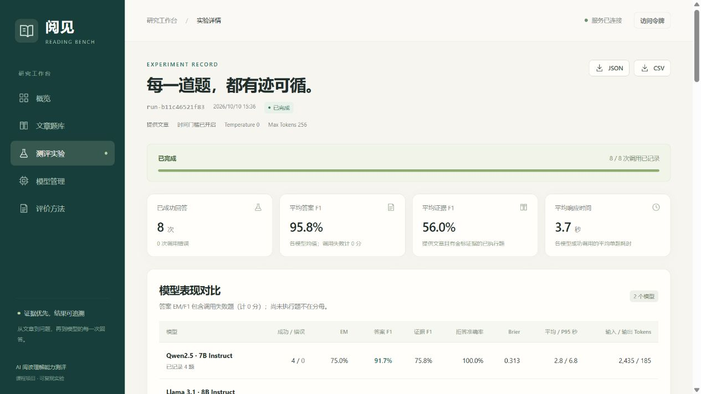
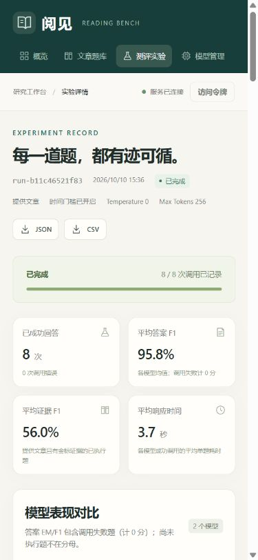
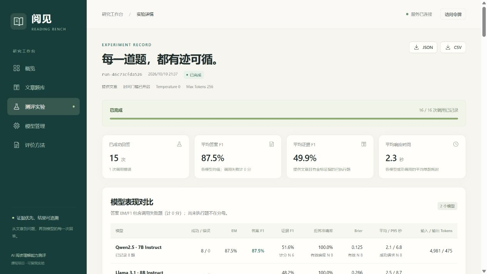
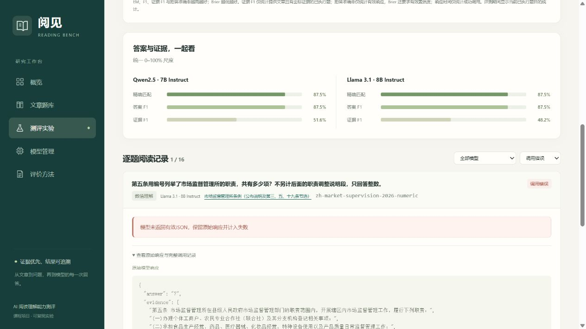
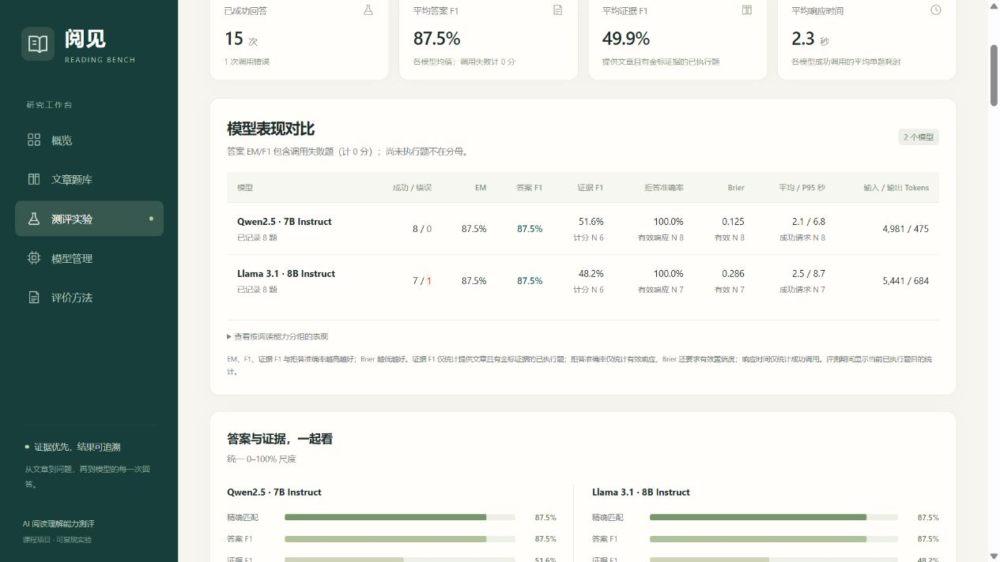
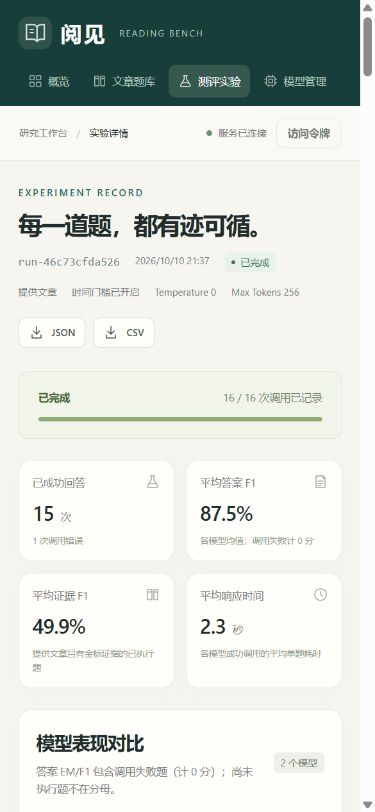
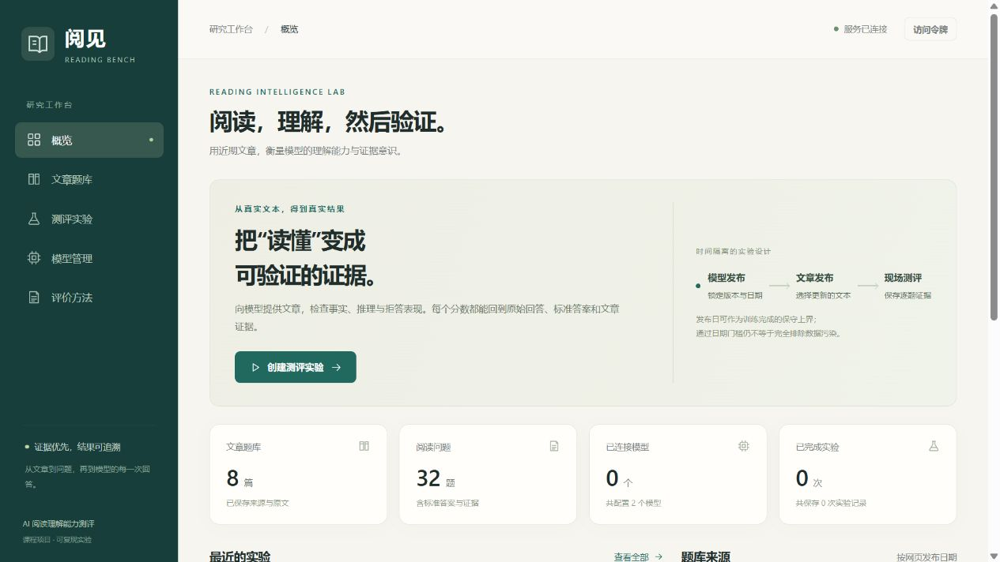

# 浏览器验收记录

验收日期：2026-10-10（中国标准时间）。对象：本机 `http://127.0.0.1:8787`，平台版本 1.1.0。使用 Codex In-app Browser 的 CUA 接口实际操作；默认桌面视口与 390×844 手机视口。题库当时为 8 篇、32 题，两模型可调用。

本记录验证页面与保存结果的连接，不将小题库分数解释为模型总体阅读能力，也不将时间门槛解释为无训练污染证明。

## 已完成的浏览器检查

| 操作 | 观察结果 |
| --- | --- |
| 概览、文章题库、测评实验、模型管理、评价方法五个主路由 | 页面标题与导航正确，服务显示已连接，均有实际 API 数据 |
| 题库搜索 `Brown Dwarfs` | 1 篇、4 题，显示 2026-10-08 NASA 文章、来源链接、正文、标准答案与证据 |
| 题库搜索 `zznoarticlezz`，随后清空 | 0 篇、0 题的空状态正确；清空后恢复全部题库 |
| 文章日期展示 | 法规同时显示网页发布日期与较早的原公布日／时间门槛日期；不是一律使用转载网页日期 |
| 选择两篇共 8 题、两模型，上限设为 6 | 每模型 6 题，预览共 12 次调用 |
| 同样选择、上限设为 20 | 封顶为每模型 8 题，共 16 次调用；上限是每模型总题数 |
| 上限设为 201，点击开始测评 | 显示 1–200 整数的错误提示，留在设置页，没有创建新实验 |
| 模型管理的检查连接 | 两模型状态刷新，当前与预期 digest 一致，日期／版本门槛通过 |
| 有文章历史实验 `run-b11c46521f83` | 完成进度 8/8，显示两模型逐题回答、金标答案／证据、汇总分数 |
| 历史实验的模型／结果筛选 | Qwen 筛出 4/8 条；再选未精确匹配得到 1/8 条；调用错误筛选为空时显示明确空状态 |
| 错例的原始响应展开 | `s30` 的原始 JSON、`30` 的历史标准答案、`gold_evidence`、原始评分器版本和完整记录可见 |
| JSON／CSV 按钮 | 实际下载到本机 Downloads，页面显示成功提示 |
| 无文章历史实验 `run-3933bc890c13` | 完成进度 8/8；证据 F1 显示 `—`，没有把未测量值显示为 0 |
| 390×844 下五个主路由及实验详情 | 文档／body 的 scrollWidth 均为 375px（视口 390px、滚动条占约 15px），无页面横向溢出；表格和导航在各自容器内滚动 |
| 浏览器警告／错误日志 | 本次检查结束时未捕获 warn/error |

## 近期真实运行追加验收

部署验收随后完成了两篇 2026 年近期文章的真实运行；浏览器重新加载后读取到它们。以下检查只读取已完成结果，没有额外调用模型。

| 操作 | 观察结果 |
| --- | --- |
| 有文章 `run-46c73cfda526` | 16/16 次已记录、15 次成功、1 次错误；两模型各 8 题，显示的旧实验输出预算仍为 256 |
| 选择调用错误筛选 | 1/16 条，明确标为 Llama 的职责计数题，错误为“模型未返回有效JSON，保留原始响应并计入失败” |
| 展开错误的完整记录 | 原始响应在 `confidence: 1,` 处结束，没有闭合 JSON；`output_tokens` 为 256；EM/F1/证据 F1 计 0，拒答校准为空，评分版本为 v1.1 |
| 失败分母的独立 API 核对 | Llama EM/F1 为 7/8 = 87.5%；拒答分母为 7 个有效响应、Brier 有效 N 为 7；耗时与 7 个成功调用的平均一致，排除失败耗时 |
| 指标表分母显示 | Llama 证据计分 N 6，拒答有效响应 N 7，Brier 有效 N 7，延迟成功请求 N 7；Qwen 对应为 6／8／8／8 |
| 无文章 `run-4eb8f88987fd` | 16/16 次成功、逐题区 16/16 条；证据 F1 显示 `—` |
| 新实验默认配置 | 页面输入值为 512，提示“建议 512，证据过长可能截断”；每模型题目上限仍默认 4；没有改写已有 run 配置 |
| 新实验手机视口 | 390×844 下 document/body 为 375px，无页面横向溢出 |

## 导出核对

实际浏览器下载文件为 `C:/Users/13412/Downloads/run-b11c46521f83.json` 和同名 `.csv`。JSON 有 8 条结果、1 篇文章快照、2 个模型快照；CSV 有 8 行逐题记录。用本地文件读取和平台 API 独立核对，CSV 每行的模型／题目组合、原始响应、EM、F1 均与 API 保存值一致。

历史页面的 Qwen EM/F1 为 75.0%／91.7%，Llama 为 100.0%／100.0%；这些显示值对应保存汇总，不表示新的 1.1 评分器重跑结果。逐题原始记录保留当时的 `reading-grader-v1.0` 标识。

## 本次修复

- 实验详情原先写“失败不计入均值”“分数来自成功调用”，与后端不一致。已改为答案 EM/F1 的调用失败计 0 分，未执行题不入当前分母；证据 F1 只统计提供文章且有金标证据的已执行题，拒答仅统计有效响应，Brier 还要求有效置信度，耗时仅统计成功调用。
- 方法页原先称“以人工复核的文章问题为单位”。已明确当前示例标注由 AI 整理并做静态校验，正式测评前仍需独立人工复核。
- 历史实验“实验材料与完整配置”的模型名和文章名优先从本次 run 快照读取，避免当前题库／注册表变化改写历史名称。逐题金标证据优先读取保存的 `gold_evidence`，之后才兼容旧记录。
- 因近期实测出现长证据导致 JSON 截断，新实验最大输出 Token 默认值从 256 调整为 512，并提示长证据可能截断；既有实验仍保留原预算。
- 模型对比表增加证据计分 N、拒答有效响应 N、Brier 有效 N、耗时成功请求 N，明确各指标分母。

## 服务器静态页面验收

通过已建立的 SSH 隧道读取 `http://127.0.0.1:8877`。服务器页面显示服务已连接、8 篇 32 题、2 个模型已配置但可调用 0 个、0 次实验记录。概览和另外四个主路由均显示正确标题和 API 数据，未见 alert，浏览器未捕获 warn/error。模型仍在下载时，实验启动按钮保持禁用。本次没有在服务器发起模型调用。

上述静态检查发生于模型下载阶段。之后已同步512默认预算的最终前端，服务器与本机 `frontend/app.js` SHA256均为 `25310264bbcfa215feecdeddf491072dc81786890ca1a45bed8323084fad67b8`。服务器两个模型已下载并完成真实平台实验；2026-10-11恢复后API读取两条completed实验各8/8，详见 `verification.md`。没有声称为恢复后的页面重新完成整套浏览器测试。

## 截图与边界

手机视口测试后已恢复默认尺寸。此次没有为浏览器验收另外发起模型调用；使用上述已完成真实实验。未在浏览器中人为断开模型或插入失败实验，实测中的 JSON 截断错误已检查。导入 JSON、添加新模型与取消正在执行的调用不在本次浏览器操作范围。
