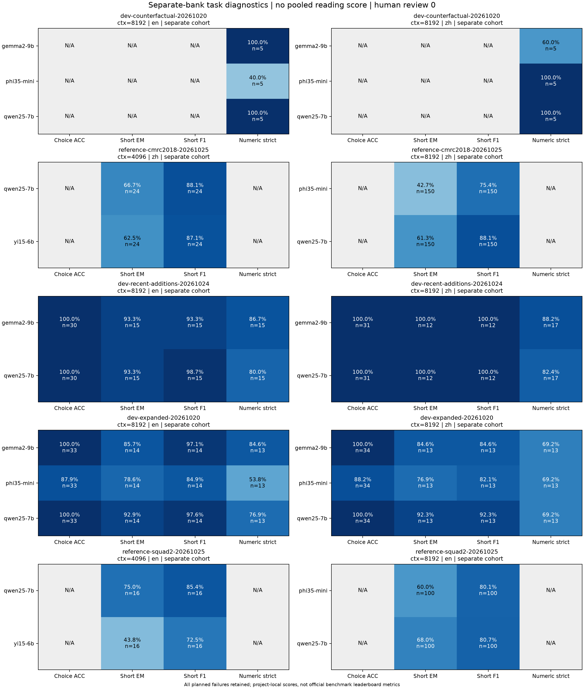
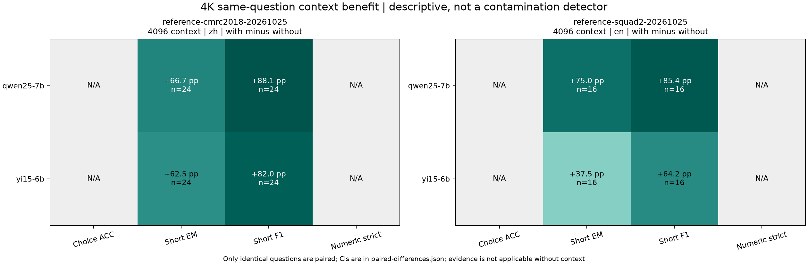

# 扩展模型与异质题库：可审计开发诊断

分析版本`reading-expansion-analysis-v1-20261025`。本报告只描述所提供目录中完成、封存且复核通过的矩阵；不推断尚未启动的其他实验。

核验 13 份矩阵、23 个run、1862 条模型题目记录、1862 个全局唯一attempt。218 条响应错误保留于计划分母，不删除、不自动重试。

## 数据与比较边界

每个source bank canonical、模型、mode、num_ctx和语言分别报告。近期AI题稿、公开历史参考及合成诊断不合并总分或文章数量；公开数据的passage不自动等于独立上游文章。单语言题库只报告实际语言，缺题型为N/A。metadata.json给完整bank身份、覆盖、来源簇与每run配置。

公开SQuAD/CMRC参考可能被训练见过，关闭不适用的时间隔离；答案使用原公开标注，但本项目人审为0。短答F1/EM按本项目规范化，不能当作官方榜单分数。其evidence只由answer span派生，数值表以span_proxy_*_aux单列，不能解释为真实推理证据定位。

4K子集和8K全量的均值不可直接相减。全部有/无文、模型以及窗口差值只在相同canonical、相同语言、完全相同article/question交集上计算；paired-differences.json列两侧全量、匹配题数和被排除数量。自动枚举的模型对比均为探索性，不冒充原始预注册。

## 有原文任务结果

| 题库（canonical分组） | 窗口 | 模型 | 语言 | 指标 | 估计% | 适用题数 | 来源簇 | 95% CI% |
|---|---:|---|---|---|---:|---:|---:|---|
| dev-counterfactual-20261020 | 8192 | gemma2-9b | en | choice_accuracy | N/A | 0 | 0 | N/A |
| dev-counterfactual-20261020 | 8192 | gemma2-9b | en | short_em | N/A | 0 | 0 | N/A |
| dev-counterfactual-20261020 | 8192 | gemma2-9b | en | short_token_f1 | N/A | 0 | 0 | N/A |
| dev-counterfactual-20261020 | 8192 | gemma2-9b | en | numeric_strict_accuracy | 100.00 | 5 | 5 | [100.00, 100.00] |
| dev-counterfactual-20261020 | 8192 | gemma2-9b | en | correct_refusal_rate | N/A | 0 | 0 | N/A |
| dev-counterfactual-20261020 | 8192 | gemma2-9b | en | format_error_rate | 0.00 | 5 | 5 | [0.00, 0.00] |
| dev-counterfactual-20261020 | 8192 | gemma2-9b | zh | choice_accuracy | N/A | 0 | 0 | N/A |
| dev-counterfactual-20261020 | 8192 | gemma2-9b | zh | short_em | N/A | 0 | 0 | N/A |
| dev-counterfactual-20261020 | 8192 | gemma2-9b | zh | short_token_f1 | N/A | 0 | 0 | N/A |
| dev-counterfactual-20261020 | 8192 | gemma2-9b | zh | numeric_strict_accuracy | 60.00 | 5 | 5 | [20.00, 100.00] |
| dev-counterfactual-20261020 | 8192 | gemma2-9b | zh | correct_refusal_rate | N/A | 0 | 0 | N/A |
| dev-counterfactual-20261020 | 8192 | gemma2-9b | zh | format_error_rate | 20.00 | 5 | 5 | [0.00, 60.00] |
| dev-counterfactual-20261020 | 8192 | phi35-mini | en | choice_accuracy | N/A | 0 | 0 | N/A |
| dev-counterfactual-20261020 | 8192 | phi35-mini | en | short_em | N/A | 0 | 0 | N/A |
| dev-counterfactual-20261020 | 8192 | phi35-mini | en | short_token_f1 | N/A | 0 | 0 | N/A |
| dev-counterfactual-20261020 | 8192 | phi35-mini | en | numeric_strict_accuracy | 40.00 | 5 | 5 | [0.00, 80.00] |
| dev-counterfactual-20261020 | 8192 | phi35-mini | en | correct_refusal_rate | N/A | 0 | 0 | N/A |
| dev-counterfactual-20261020 | 8192 | phi35-mini | en | format_error_rate | 0.00 | 5 | 5 | [0.00, 0.00] |
| dev-counterfactual-20261020 | 8192 | phi35-mini | zh | choice_accuracy | N/A | 0 | 0 | N/A |
| dev-counterfactual-20261020 | 8192 | phi35-mini | zh | short_em | N/A | 0 | 0 | N/A |
| dev-counterfactual-20261020 | 8192 | phi35-mini | zh | short_token_f1 | N/A | 0 | 0 | N/A |
| dev-counterfactual-20261020 | 8192 | phi35-mini | zh | numeric_strict_accuracy | 100.00 | 5 | 5 | [100.00, 100.00] |
| dev-counterfactual-20261020 | 8192 | phi35-mini | zh | correct_refusal_rate | N/A | 0 | 0 | N/A |
| dev-counterfactual-20261020 | 8192 | phi35-mini | zh | format_error_rate | 0.00 | 5 | 5 | [0.00, 0.00] |
| dev-counterfactual-20261020 | 8192 | qwen25-7b | en | choice_accuracy | N/A | 0 | 0 | N/A |
| dev-counterfactual-20261020 | 8192 | qwen25-7b | en | short_em | N/A | 0 | 0 | N/A |
| dev-counterfactual-20261020 | 8192 | qwen25-7b | en | short_token_f1 | N/A | 0 | 0 | N/A |
| dev-counterfactual-20261020 | 8192 | qwen25-7b | en | numeric_strict_accuracy | 100.00 | 5 | 5 | [100.00, 100.00] |
| dev-counterfactual-20261020 | 8192 | qwen25-7b | en | correct_refusal_rate | N/A | 0 | 0 | N/A |
| dev-counterfactual-20261020 | 8192 | qwen25-7b | en | format_error_rate | 0.00 | 5 | 5 | [0.00, 0.00] |
| dev-counterfactual-20261020 | 8192 | qwen25-7b | zh | choice_accuracy | N/A | 0 | 0 | N/A |
| dev-counterfactual-20261020 | 8192 | qwen25-7b | zh | short_em | N/A | 0 | 0 | N/A |
| dev-counterfactual-20261020 | 8192 | qwen25-7b | zh | short_token_f1 | N/A | 0 | 0 | N/A |
| dev-counterfactual-20261020 | 8192 | qwen25-7b | zh | numeric_strict_accuracy | 100.00 | 5 | 5 | [100.00, 100.00] |
| dev-counterfactual-20261020 | 8192 | qwen25-7b | zh | correct_refusal_rate | N/A | 0 | 0 | N/A |
| dev-counterfactual-20261020 | 8192 | qwen25-7b | zh | format_error_rate | 0.00 | 5 | 5 | [0.00, 0.00] |
| reference-cmrc2018-20261025 | 8192 | phi35-mini | zh | choice_accuracy | N/A | 0 | 0 | N/A |
| reference-cmrc2018-20261025 | 8192 | phi35-mini | zh | short_em | 42.67 | 150 | 50 | [34.00, 51.33] |
| reference-cmrc2018-20261025 | 8192 | phi35-mini | zh | short_token_f1 | 75.43 | 150 | 50 | [70.35, 80.14] |
| reference-cmrc2018-20261025 | 8192 | phi35-mini | zh | numeric_strict_accuracy | N/A | 0 | 0 | N/A |
| reference-cmrc2018-20261025 | 8192 | phi35-mini | zh | correct_refusal_rate | N/A | 0 | 0 | N/A |
| reference-cmrc2018-20261025 | 8192 | phi35-mini | zh | format_error_rate | 0.00 | 150 | 50 | [0.00, 0.00] |
| reference-cmrc2018-20261025 | 4096 | qwen25-7b | zh | choice_accuracy | N/A | 0 | 0 | N/A |
| reference-cmrc2018-20261025 | 4096 | qwen25-7b | zh | short_em | 66.67 | 24 | 8 | [45.83, 87.50] |
| reference-cmrc2018-20261025 | 4096 | qwen25-7b | zh | short_token_f1 | 88.07 | 24 | 8 | [79.41, 97.25] |
| reference-cmrc2018-20261025 | 4096 | qwen25-7b | zh | numeric_strict_accuracy | N/A | 0 | 0 | N/A |
| reference-cmrc2018-20261025 | 4096 | qwen25-7b | zh | correct_refusal_rate | N/A | 0 | 0 | N/A |
| reference-cmrc2018-20261025 | 4096 | qwen25-7b | zh | format_error_rate | 0.00 | 24 | 8 | [0.00, 0.00] |
| reference-cmrc2018-20261025 | 8192 | qwen25-7b | zh | choice_accuracy | N/A | 0 | 0 | N/A |
| reference-cmrc2018-20261025 | 8192 | qwen25-7b | zh | short_em | 61.33 | 150 | 50 | [53.33, 69.33] |
| reference-cmrc2018-20261025 | 8192 | qwen25-7b | zh | short_token_f1 | 88.08 | 150 | 50 | [84.60, 91.48] |
| reference-cmrc2018-20261025 | 8192 | qwen25-7b | zh | numeric_strict_accuracy | N/A | 0 | 0 | N/A |
| reference-cmrc2018-20261025 | 8192 | qwen25-7b | zh | correct_refusal_rate | N/A | 0 | 0 | N/A |
| reference-cmrc2018-20261025 | 8192 | qwen25-7b | zh | format_error_rate | 0.00 | 150 | 50 | [0.00, 0.00] |
| reference-cmrc2018-20261025 | 4096 | yi15-6b | zh | choice_accuracy | N/A | 0 | 0 | N/A |
| reference-cmrc2018-20261025 | 4096 | yi15-6b | zh | short_em | 62.50 | 24 | 8 | [37.50, 83.33] |
| reference-cmrc2018-20261025 | 4096 | yi15-6b | zh | short_token_f1 | 87.08 | 24 | 8 | [77.54, 95.40] |
| reference-cmrc2018-20261025 | 4096 | yi15-6b | zh | numeric_strict_accuracy | N/A | 0 | 0 | N/A |
| reference-cmrc2018-20261025 | 4096 | yi15-6b | zh | correct_refusal_rate | N/A | 0 | 0 | N/A |
| reference-cmrc2018-20261025 | 4096 | yi15-6b | zh | format_error_rate | 0.00 | 24 | 8 | [0.00, 0.00] |
| dev-recent-additions-20261024 | 8192 | gemma2-9b | en | choice_accuracy | 100.00 | 30 | 10 | [100.00, 100.00] |
| dev-recent-additions-20261024 | 8192 | gemma2-9b | en | short_em | 93.33 | 15 | 10 | [76.92, 100.00] |
| dev-recent-additions-20261024 | 8192 | gemma2-9b | en | short_token_f1 | 93.33 | 15 | 10 | [76.92, 100.00] |
| dev-recent-additions-20261024 | 8192 | gemma2-9b | en | numeric_strict_accuracy | 86.67 | 15 | 10 | [72.22, 100.00] |
| dev-recent-additions-20261024 | 8192 | gemma2-9b | en | correct_refusal_rate | 95.00 | 20 | 10 | [85.00, 100.00] |
| dev-recent-additions-20261024 | 8192 | gemma2-9b | en | format_error_rate | 1.25 | 80 | 10 | [0.00, 3.75] |
| dev-recent-additions-20261024 | 8192 | gemma2-9b | zh | choice_accuracy | 100.00 | 31 | 10 | [100.00, 100.00] |
| dev-recent-additions-20261024 | 8192 | gemma2-9b | zh | short_em | 100.00 | 12 | 9 | [100.00, 100.00] |
| dev-recent-additions-20261024 | 8192 | gemma2-9b | zh | short_token_f1 | 100.00 | 12 | 9 | [100.00, 100.00] |
| dev-recent-additions-20261024 | 8192 | gemma2-9b | zh | numeric_strict_accuracy | 88.24 | 17 | 9 | [72.22, 100.00] |
| dev-recent-additions-20261024 | 8192 | gemma2-9b | zh | correct_refusal_rate | 55.00 | 20 | 10 | [30.00, 80.00] |
| dev-recent-additions-20261024 | 8192 | gemma2-9b | zh | format_error_rate | 11.25 | 80 | 10 | [5.00, 17.50] |
| dev-recent-additions-20261024 | 8192 | qwen25-7b | en | choice_accuracy | 100.00 | 30 | 10 | [100.00, 100.00] |
| dev-recent-additions-20261024 | 8192 | qwen25-7b | en | short_em | 93.33 | 15 | 10 | [80.00, 100.00] |
| dev-recent-additions-20261024 | 8192 | qwen25-7b | en | short_token_f1 | 98.67 | 15 | 10 | [96.00, 100.00] |
| dev-recent-additions-20261024 | 8192 | qwen25-7b | en | numeric_strict_accuracy | 80.00 | 15 | 10 | [64.71, 100.00] |
| dev-recent-additions-20261024 | 8192 | qwen25-7b | en | correct_refusal_rate | 0.00 | 20 | 10 | [0.00, 0.00] |
| dev-recent-additions-20261024 | 8192 | qwen25-7b | en | format_error_rate | 23.75 | 80 | 10 | [21.25, 25.00] |
| dev-recent-additions-20261024 | 8192 | qwen25-7b | zh | choice_accuracy | 100.00 | 31 | 10 | [100.00, 100.00] |
| dev-recent-additions-20261024 | 8192 | qwen25-7b | zh | short_em | 100.00 | 12 | 9 | [100.00, 100.00] |
| dev-recent-additions-20261024 | 8192 | qwen25-7b | zh | short_token_f1 | 100.00 | 12 | 9 | [100.00, 100.00] |
| dev-recent-additions-20261024 | 8192 | qwen25-7b | zh | numeric_strict_accuracy | 82.35 | 17 | 9 | [65.00, 100.00] |
| dev-recent-additions-20261024 | 8192 | qwen25-7b | zh | correct_refusal_rate | 85.00 | 20 | 10 | [65.00, 100.00] |
| dev-recent-additions-20261024 | 8192 | qwen25-7b | zh | format_error_rate | 1.25 | 80 | 10 | [0.00, 3.75] |
| dev-expanded-20261020 | 8192 | gemma2-9b | en | choice_accuracy | 100.00 | 33 | 10 | [100.00, 100.00] |
| dev-expanded-20261020 | 8192 | gemma2-9b | en | short_em | 85.71 | 14 | 9 | [66.67, 100.00] |
| dev-expanded-20261020 | 8192 | gemma2-9b | en | short_token_f1 | 97.14 | 14 | 9 | [93.33, 100.00] |
| dev-expanded-20261020 | 8192 | gemma2-9b | en | numeric_strict_accuracy | 84.62 | 13 | 8 | [62.48, 100.00] |
| dev-expanded-20261020 | 8192 | gemma2-9b | en | correct_refusal_rate | 95.00 | 20 | 10 | [85.00, 100.00] |
| dev-expanded-20261020 | 8192 | gemma2-9b | en | format_error_rate | 1.25 | 80 | 10 | [0.00, 3.75] |
| dev-expanded-20261020 | 8192 | gemma2-9b | zh | choice_accuracy | 100.00 | 34 | 10 | [100.00, 100.00] |
| dev-expanded-20261020 | 8192 | gemma2-9b | zh | short_em | 84.62 | 13 | 8 | [53.85, 100.00] |
| dev-expanded-20261020 | 8192 | gemma2-9b | zh | short_token_f1 | 84.62 | 13 | 8 | [53.85, 100.00] |
| dev-expanded-20261020 | 8192 | gemma2-9b | zh | numeric_strict_accuracy | 69.23 | 13 | 8 | [50.00, 88.89] |
| dev-expanded-20261020 | 8192 | gemma2-9b | zh | correct_refusal_rate | 45.00 | 20 | 10 | [20.00, 70.00] |
| dev-expanded-20261020 | 8192 | gemma2-9b | zh | format_error_rate | 13.75 | 80 | 10 | [7.50, 20.00] |
| dev-expanded-20261020 | 8192 | phi35-mini | en | choice_accuracy | 87.88 | 33 | 10 | [73.53, 100.00] |
| dev-expanded-20261020 | 8192 | phi35-mini | en | short_em | 78.57 | 14 | 9 | [57.14, 100.00] |
| dev-expanded-20261020 | 8192 | phi35-mini | en | short_token_f1 | 84.92 | 14 | 9 | [63.49, 100.00] |
| dev-expanded-20261020 | 8192 | phi35-mini | en | numeric_strict_accuracy | 53.85 | 13 | 8 | [28.57, 78.57] |
| dev-expanded-20261020 | 8192 | phi35-mini | en | correct_refusal_rate | 0.00 | 20 | 10 | [0.00, 0.00] |
| dev-expanded-20261020 | 8192 | phi35-mini | en | format_error_rate | 27.50 | 80 | 10 | [25.00, 31.25] |
| dev-expanded-20261020 | 8192 | phi35-mini | zh | choice_accuracy | 88.24 | 34 | 10 | [73.53, 100.00] |
| dev-expanded-20261020 | 8192 | phi35-mini | zh | short_em | 76.92 | 13 | 8 | [41.67, 100.00] |
| dev-expanded-20261020 | 8192 | phi35-mini | zh | short_token_f1 | 82.05 | 13 | 8 | [55.54, 100.00] |
| dev-expanded-20261020 | 8192 | phi35-mini | zh | numeric_strict_accuracy | 69.23 | 13 | 8 | [57.89, 87.50] |
| dev-expanded-20261020 | 8192 | phi35-mini | zh | correct_refusal_rate | 0.00 | 20 | 10 | [0.00, 0.00] |
| dev-expanded-20261020 | 8192 | phi35-mini | zh | format_error_rate | 18.75 | 80 | 10 | [13.75, 23.75] |
| dev-expanded-20261020 | 8192 | qwen25-7b | en | choice_accuracy | 100.00 | 33 | 10 | [100.00, 100.00] |
| dev-expanded-20261020 | 8192 | qwen25-7b | en | short_em | 92.86 | 14 | 9 | [72.73, 100.00] |
| dev-expanded-20261020 | 8192 | qwen25-7b | en | short_token_f1 | 97.62 | 14 | 9 | [90.91, 100.00] |
| dev-expanded-20261020 | 8192 | qwen25-7b | en | numeric_strict_accuracy | 76.92 | 13 | 8 | [53.85, 100.00] |
| dev-expanded-20261020 | 8192 | qwen25-7b | en | correct_refusal_rate | 15.00 | 20 | 10 | [0.00, 30.00] |
| dev-expanded-20261020 | 8192 | qwen25-7b | en | format_error_rate | 20.00 | 80 | 10 | [16.25, 23.75] |
| dev-expanded-20261020 | 8192 | qwen25-7b | zh | choice_accuracy | 100.00 | 34 | 10 | [100.00, 100.00] |
| dev-expanded-20261020 | 8192 | qwen25-7b | zh | short_em | 92.31 | 13 | 8 | [76.92, 100.00] |
| dev-expanded-20261020 | 8192 | qwen25-7b | zh | short_token_f1 | 92.31 | 13 | 8 | [76.92, 100.00] |
| dev-expanded-20261020 | 8192 | qwen25-7b | zh | numeric_strict_accuracy | 69.23 | 13 | 8 | [50.00, 88.89] |
| dev-expanded-20261020 | 8192 | qwen25-7b | zh | correct_refusal_rate | 80.00 | 20 | 10 | [59.88, 100.00] |
| dev-expanded-20261020 | 8192 | qwen25-7b | zh | format_error_rate | 3.75 | 80 | 10 | [0.00, 7.50] |
| reference-squad2-20261025 | 8192 | phi35-mini | en | choice_accuracy | N/A | 0 | 0 | N/A |
| reference-squad2-20261025 | 8192 | phi35-mini | en | short_em | 60.00 | 100 | 35 | [50.00, 69.39] |
| reference-squad2-20261025 | 8192 | phi35-mini | en | short_token_f1 | 80.14 | 100 | 35 | [73.06, 86.40] |
| reference-squad2-20261025 | 8192 | phi35-mini | en | numeric_strict_accuracy | N/A | 0 | 0 | N/A |
| reference-squad2-20261025 | 8192 | phi35-mini | en | correct_refusal_rate | 0.00 | 50 | 35 | [0.00, 0.00] |
| reference-squad2-20261025 | 8192 | phi35-mini | en | format_error_rate | 10.67 | 150 | 35 | [6.52, 14.89] |
| reference-squad2-20261025 | 4096 | qwen25-7b | en | choice_accuracy | N/A | 0 | 0 | N/A |
| reference-squad2-20261025 | 4096 | qwen25-7b | en | short_em | 75.00 | 16 | 8 | [56.25, 93.75] |
| reference-squad2-20261025 | 4096 | qwen25-7b | en | short_token_f1 | 85.42 | 16 | 8 | [68.75, 97.92] |
| reference-squad2-20261025 | 4096 | qwen25-7b | en | numeric_strict_accuracy | N/A | 0 | 0 | N/A |
| reference-squad2-20261025 | 4096 | qwen25-7b | en | correct_refusal_rate | 12.50 | 8 | 8 | [0.00, 37.50] |
| reference-squad2-20261025 | 4096 | qwen25-7b | en | format_error_rate | 20.83 | 24 | 8 | [8.33, 33.33] |
| reference-squad2-20261025 | 8192 | qwen25-7b | en | choice_accuracy | N/A | 0 | 0 | N/A |
| reference-squad2-20261025 | 8192 | qwen25-7b | en | short_em | 68.00 | 100 | 35 | [58.00, 77.45] |
| reference-squad2-20261025 | 8192 | qwen25-7b | en | short_token_f1 | 80.72 | 100 | 35 | [73.54, 87.61] |
| reference-squad2-20261025 | 8192 | qwen25-7b | en | numeric_strict_accuracy | N/A | 0 | 0 | N/A |
| reference-squad2-20261025 | 8192 | qwen25-7b | en | correct_refusal_rate | 6.00 | 50 | 35 | [0.00, 13.64] |
| reference-squad2-20261025 | 8192 | qwen25-7b | en | format_error_rate | 16.67 | 150 | 35 | [11.56, 21.57] |
| reference-squad2-20261025 | 4096 | yi15-6b | en | choice_accuracy | N/A | 0 | 0 | N/A |
| reference-squad2-20261025 | 4096 | yi15-6b | en | short_em | 43.75 | 16 | 8 | [18.75, 75.00] |
| reference-squad2-20261025 | 4096 | yi15-6b | en | short_token_f1 | 72.46 | 16 | 8 | [58.91, 87.22] |
| reference-squad2-20261025 | 4096 | yi15-6b | en | numeric_strict_accuracy | N/A | 0 | 0 | N/A |
| reference-squad2-20261025 | 4096 | yi15-6b | en | correct_refusal_rate | 0.00 | 8 | 8 | [0.00, 0.00] |
| reference-squad2-20261025 | 4096 | yi15-6b | en | format_error_rate | 4.17 | 24 | 8 | [0.00, 12.50] |

完整题型分解、有效输出子集、证据/拒答/错误指标见numeric-table.csv/json。有效输出子集只辅助诊断，不能替代包含失败的计划分母。无文条件不评分证据。实质误答率和误拒答率在无效响应上也记0，其低值不能单独说明可靠或少幻觉。

## 图与解释

各面板独立显示题型点估计和适用题数。N/A表示未覆盖；面板材料不同，颜色或数值不能直接作跨bank/窗口能力排序。该图用于识别任务覆盖和待复核的错误方向；详细CI在数值表。

差值为有文减无文，单位百分点，并列配对题数。只使用同一bank、模型、4K窗口下的同题交集；原始8K全量没有直接参与相减。正差支持本子集取得文本后有帮助，不能证明训练无污染或纯理解增益。

## 失败与复现

wrong-cases.json保留答案错误、输出错误及证据不匹配的原始响应/金标。公开参考的证据不匹配明确标aux。error-types.json与efficiency.json分组记录错误和端到端耗时；耗时含加载、调度、序列化，不能当纯解码速度。GPU驻留只为采样观察；缺少对应观察不会被写成已证明GPU执行。

metadata.json、bundle-manifest.json记录题库身份、选择、模型digest、版本及上游/产物hash。所有统计限于这批完整输入；与10月20日不同runner的历史8配置不得混合重采样。正式隐藏集、双人独立审题和多seed实验仍未因此完成。
