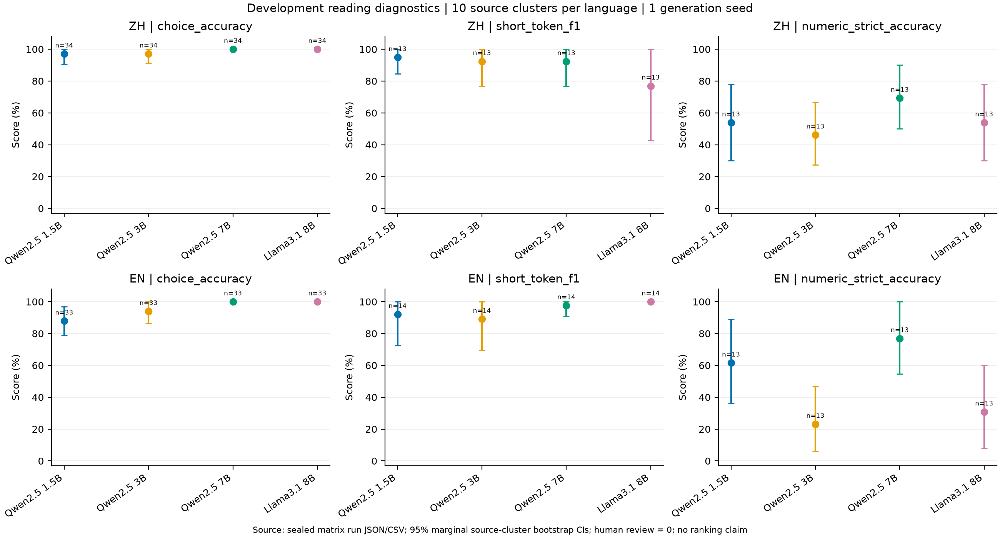
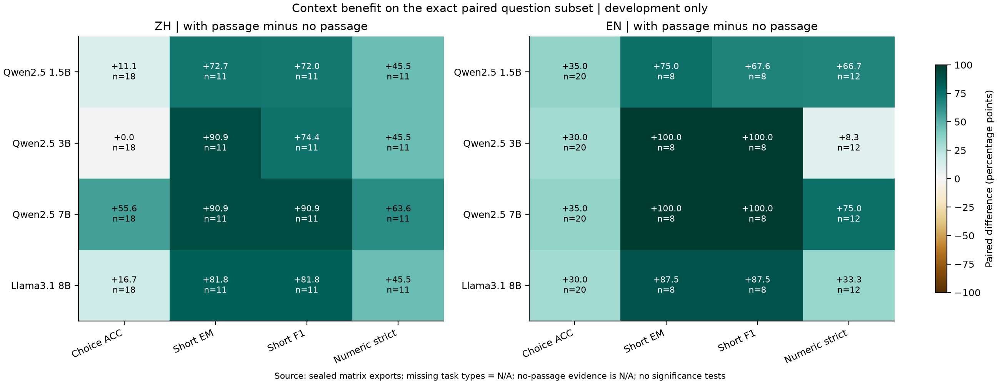

# 多模型阅读测评开发诊断

分析版本：`reading-matrix-analysis-v1-20261020`。仅分析经过 hash、计划、原始输出及评分器复核的完整矩阵导出。

本次包含 4 个固定模型、20 篇文章、960 条模型题目记录；中文和英文各 10 个源文章簇，生成 seed=42、temperature=0，仅一次。人工审题为 0，formal=false。

比较问题：同系列参数规模变化、名义 7B 附近不同研发机构模型，以及相同题目的有原文与无原文差值。跨机构对比同时受到训练数据、架构、分词器、模板及量化差异影响，不能解释为研发机构单因素的因果效果。

指标按语言、题型分别报告。选择题 ACC、短答 EM/项目自定义 token F1、严格数值正确率是答案指标；证据 EM/F1、拒答、误拒答和格式失败单独报告。没有全题合成总分，也不据此给出正式名次。

共发现 135 条执行或响应契约错误，全部留在计划分母并按相应成功指标记 0；完整原始错误及答错样本见 `wrong-cases.json`，错误类型见 `error-types.json`。有效输出子集只作补充诊断。

## 精确数值表

| 模型 | 语言 | 指标 | 估计 % | 95% 簇 bootstrap CI % | 分母 | 源文章簇 |
|---|---|---|---:|---|---:|---:|
| Qwen2.5 1.5B | zh | choice_accuracy | 97.06 | [90.32, 100.00] | 34 | 10 |
| Qwen2.5 1.5B | zh | short_em | 84.62 | [53.85, 100.00] | 13 | 8 |
| Qwen2.5 1.5B | zh | short_token_f1 | 94.87 | [84.62, 100.00] | 13 | 8 |
| Qwen2.5 1.5B | zh | numeric_strict_accuracy | 53.85 | [30.00, 77.78] | 13 | 8 |
| Qwen2.5 1.5B | zh | evidence_exact_answerable | 18.33 | [8.33, 30.00] | 60 | 10 |
| Qwen2.5 1.5B | zh | evidence_f1_answerable | 27.50 | [11.67, 43.89] | 60 | 10 |
| Qwen2.5 1.5B | zh | correct_refusal_rate | 0.00 | [0.00, 0.00] | 20 | 10 |
| Qwen2.5 1.5B | zh | false_refusal_rate | 0.00 | [0.00, 0.00] | 60 | 10 |
| Qwen2.5 1.5B | zh | format_error_rate | 3.75 | [0.00, 7.50] | 80 | 10 |
| Qwen2.5 1.5B | en | choice_accuracy | 87.88 | [78.79, 96.97] | 33 | 10 |
| Qwen2.5 1.5B | en | short_em | 85.71 | [63.64, 100.00] | 14 | 9 |
| Qwen2.5 1.5B | en | short_token_f1 | 92.06 | [72.70, 100.00] | 14 | 9 |
| Qwen2.5 1.5B | en | numeric_strict_accuracy | 61.54 | [36.35, 88.89] | 13 | 8 |
| Qwen2.5 1.5B | en | evidence_exact_answerable | 16.67 | [3.33, 31.67] | 60 | 10 |
| Qwen2.5 1.5B | en | evidence_f1_answerable | 19.28 | [6.50, 34.00] | 60 | 10 |
| Qwen2.5 1.5B | en | correct_refusal_rate | 0.00 | [0.00, 0.00] | 20 | 10 |
| Qwen2.5 1.5B | en | false_refusal_rate | 0.00 | [0.00, 0.00] | 60 | 10 |
| Qwen2.5 1.5B | en | format_error_rate | 11.25 | [6.25, 16.25] | 80 | 10 |
| Qwen2.5 3B | zh | choice_accuracy | 97.06 | [91.43, 100.00] | 34 | 10 |
| Qwen2.5 3B | zh | short_em | 92.31 | [76.92, 100.00] | 13 | 8 |
| Qwen2.5 3B | zh | short_token_f1 | 92.31 | [76.92, 100.00] | 13 | 8 |
| Qwen2.5 3B | zh | numeric_strict_accuracy | 46.15 | [27.27, 66.67] | 13 | 8 |
| Qwen2.5 3B | zh | evidence_exact_answerable | 66.67 | [51.67, 80.00] | 60 | 10 |
| Qwen2.5 3B | zh | evidence_f1_answerable | 75.06 | [61.55, 87.62] | 60 | 10 |
| Qwen2.5 3B | zh | correct_refusal_rate | 20.00 | [0.00, 40.00] | 20 | 10 |
| Qwen2.5 3B | zh | false_refusal_rate | 0.00 | [0.00, 0.00] | 60 | 10 |
| Qwen2.5 3B | zh | format_error_rate | 13.75 | [8.75, 18.75] | 80 | 10 |
| Qwen2.5 3B | en | choice_accuracy | 93.94 | [86.49, 100.00] | 33 | 10 |
| Qwen2.5 3B | en | short_em | 78.57 | [53.85, 100.00] | 14 | 9 |
| Qwen2.5 3B | en | short_token_f1 | 89.05 | [69.70, 100.00] | 14 | 9 |
| Qwen2.5 3B | en | numeric_strict_accuracy | 23.08 | [5.88, 46.68] | 13 | 8 |
| Qwen2.5 3B | en | evidence_exact_answerable | 56.67 | [46.67, 68.33] | 60 | 10 |
| Qwen2.5 3B | en | evidence_f1_answerable | 67.94 | [56.89, 78.67] | 60 | 10 |
| Qwen2.5 3B | en | correct_refusal_rate | 5.00 | [0.00, 15.00] | 20 | 10 |
| Qwen2.5 3B | en | false_refusal_rate | 0.00 | [0.00, 0.00] | 60 | 10 |
| Qwen2.5 3B | en | format_error_rate | 22.50 | [17.50, 27.50] | 80 | 10 |
| Qwen2.5 7B | zh | choice_accuracy | 100.00 | [100.00, 100.00] | 34 | 10 |
| Qwen2.5 7B | zh | short_em | 92.31 | [76.92, 100.00] | 13 | 8 |
| Qwen2.5 7B | zh | short_token_f1 | 92.31 | [76.92, 100.00] | 13 | 8 |
| Qwen2.5 7B | zh | numeric_strict_accuracy | 69.23 | [50.00, 90.00] | 13 | 8 |
| Qwen2.5 7B | zh | evidence_exact_answerable | 20.00 | [8.33, 31.67] | 60 | 10 |
| Qwen2.5 7B | zh | evidence_f1_answerable | 22.78 | [10.00, 35.56] | 60 | 10 |
| Qwen2.5 7B | zh | correct_refusal_rate | 80.00 | [55.00, 100.00] | 20 | 10 |
| Qwen2.5 7B | zh | false_refusal_rate | 0.00 | [0.00, 0.00] | 60 | 10 |
| Qwen2.5 7B | zh | format_error_rate | 3.75 | [0.00, 7.50] | 80 | 10 |
| Qwen2.5 7B | en | choice_accuracy | 100.00 | [100.00, 100.00] | 33 | 10 |
| Qwen2.5 7B | en | short_em | 92.86 | [72.73, 100.00] | 14 | 9 |
| Qwen2.5 7B | en | short_token_f1 | 97.62 | [90.91, 100.00] | 14 | 9 |
| Qwen2.5 7B | en | numeric_strict_accuracy | 76.92 | [54.55, 100.00] | 13 | 8 |
| Qwen2.5 7B | en | evidence_exact_answerable | 50.00 | [33.33, 68.33] | 60 | 10 |
| Qwen2.5 7B | en | evidence_f1_answerable | 60.00 | [43.89, 75.00] | 60 | 10 |
| Qwen2.5 7B | en | correct_refusal_rate | 15.00 | [0.00, 30.00] | 20 | 10 |
| Qwen2.5 7B | en | false_refusal_rate | 0.00 | [0.00, 0.00] | 60 | 10 |
| Qwen2.5 7B | en | format_error_rate | 20.00 | [16.25, 23.75] | 80 | 10 |
| Llama3.1 8B | zh | choice_accuracy | 100.00 | [100.00, 100.00] | 34 | 10 |
| Llama3.1 8B | zh | short_em | 76.92 | [42.86, 100.00] | 13 | 8 |
| Llama3.1 8B | zh | short_token_f1 | 76.92 | [42.86, 100.00] | 13 | 8 |
| Llama3.1 8B | zh | numeric_strict_accuracy | 53.85 | [30.00, 77.78] | 13 | 8 |
| Llama3.1 8B | zh | evidence_exact_answerable | 51.67 | [33.33, 70.00] | 60 | 10 |
| Llama3.1 8B | zh | evidence_f1_answerable | 54.72 | [35.28, 75.56] | 60 | 10 |
| Llama3.1 8B | zh | correct_refusal_rate | 30.00 | [15.00, 45.00] | 20 | 10 |
| Llama3.1 8B | zh | false_refusal_rate | 0.00 | [0.00, 0.00] | 60 | 10 |
| Llama3.1 8B | zh | format_error_rate | 15.00 | [8.75, 22.50] | 80 | 10 |
| Llama3.1 8B | en | choice_accuracy | 100.00 | [100.00, 100.00] | 33 | 10 |
| Llama3.1 8B | en | short_em | 100.00 | [100.00, 100.00] | 14 | 9 |
| Llama3.1 8B | en | short_token_f1 | 100.00 | [100.00, 100.00] | 14 | 9 |
| Llama3.1 8B | en | numeric_strict_accuracy | 30.77 | [7.69, 60.00] | 13 | 8 |
| Llama3.1 8B | en | evidence_exact_answerable | 80.00 | [70.00, 88.33] | 60 | 10 |
| Llama3.1 8B | en | evidence_f1_answerable | 91.89 | [88.33, 95.22] | 60 | 10 |
| Llama3.1 8B | en | correct_refusal_rate | 50.00 | [30.00, 70.00] | 20 | 10 |
| Llama3.1 8B | en | false_refusal_rate | 0.00 | [0.00, 0.00] | 60 | 10 |
| Llama3.1 8B | en | format_error_rate | 10.00 | [5.00, 15.00] | 80 | 10 |

完整题型分解、有效输出子集、分母、覆盖度和区间见 `numeric-table.csv/json`。无对应题型的值为 N/A，不能视为 0。

## 图与解释

目的：检查模型差异出现在哪种语言和答案任务。每点为包含错误在内的计划题均值，误差线为 2000 次源文章簇重采样的边际 95% 区间；点旁显示题数。zh 短答 F1 的模型点估计范围为 76.92%—94.87%；en 短答 F1 的模型点估计范围为 89.05%—100.00%。应同时查看区间和分母，不能从点估计顺序推出稳定名次。该图决定后续应优先补审哪些题型、补采哪些文章来源。

目的：测量同一模型在完全相同题目上获取原文后的答案变化。格内数值是有文减无文的百分点差及配对题数；缺失题型为 N/A。qwen25-7b 的 zh 选择题有文收益为 55.56 个百分点（n=18）；qwen25-7b 的 en 选择题有文收益为 35.00 个百分点（n=20）。具体差值区间在 `paired-differences.json`；无文证据指标不适用。正差值支持模型使用了本题上下文的局部观察，不能证明模型完全没有训练污染，负差值也不单独证明记忆或题目错误。该图用于选择需要人工复查的题目与文章。

## 允许与禁止的结论

- Claim：在指定固定权重、当前开发题稿、同一生成 seed 下观察到表列任务正确率及配对差值。
  - Source evidence：`analysis.json` 中的 source_artifacts、numeric_table 和 paired_differences；原文错误保存在 wrong-cases.json。
  - Allowed wording：当前 20 篇开发材料上的描述性诊断；比较方向与区间见具体任务。
  - Forbidden stronger wording：某模型阅读理解普遍最佳、达到正式基准水平、某公司因果优越、已排除训练污染、差异统计显著。
  - Uncertainty：每语言仅 10 个簇、单 seed、人工审题 0；CI 为探索性边际区间而非同时置信带。
  - Next check：双人独立审题及仲裁、扩大独立来源、运行多个 seed、冻结隐藏测试后再验证。
  - Decision：weaken（保留开发诊断，禁止正式排名）。

## 当前边界

执行错误与不按 JSON 契约回答反映端到端平台表现；有效回答上的补充准确率不能替代完整分母。源文章簇的不确定性不等于训练随机性或跨 seed 方差。没有进行显著性检验，也没有未经多重校正的 p 值排序。时间隔离与模型 digest 固定仅减少可观察的污染风险，文章可能沿用更早知识；无原文对照不能独立鉴别污染。

效率见 efficiency.json：保留全部端到端 p50/p95，时间包含模型加载、队列和序列化开销；后端没有保存 load_duration，不能解释为纯解码延迟。另列 warm_proxy，只剔除每个完整 run 的第一条记录，并不保证余下记录处于真正稳定热态；不会分别剔除每种语言的首条。GPU 常驻仅为采样观察。未严格认证 tokenizer 的模型预算属于探索性配置，精确 token 验证覆盖见表，不能自动与严格模式等同。
